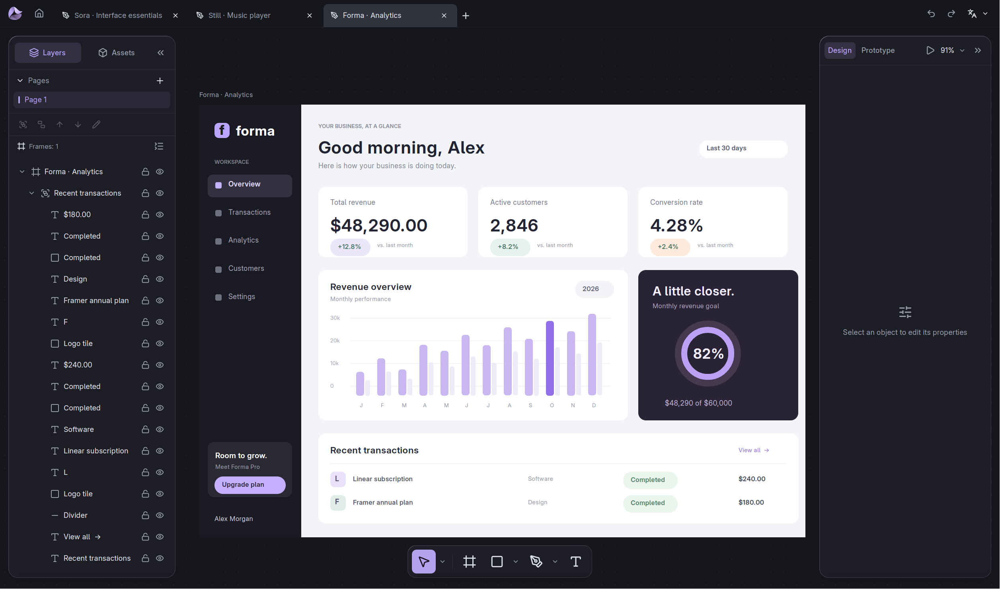
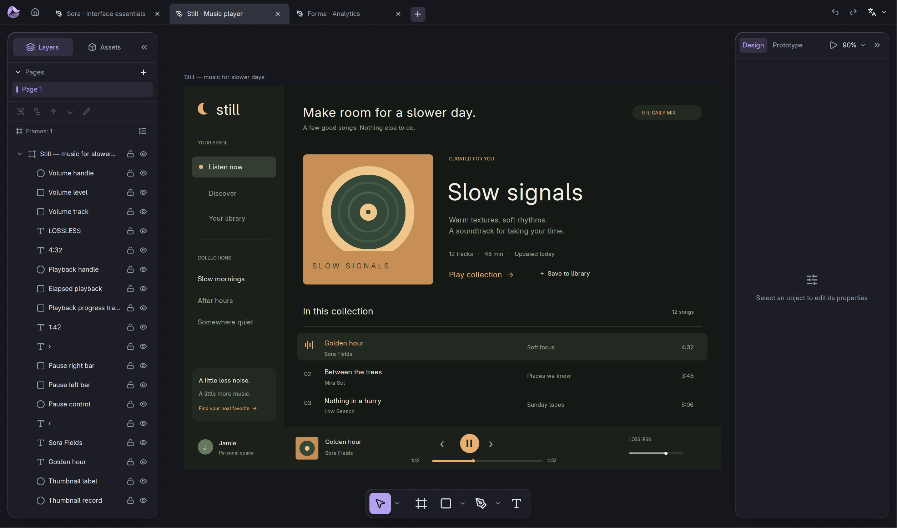
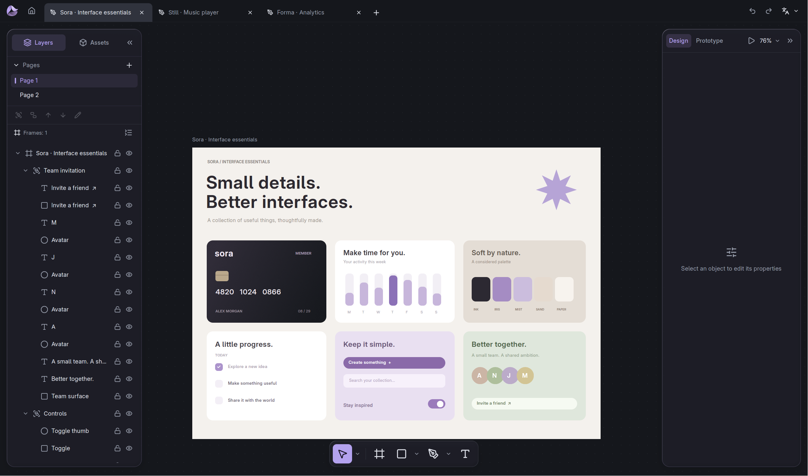

# Rovar

[English](README.md) | 简体中文

使用 Rust 和 GPUI 构建的设计编辑器，支持桌面端和 Web。可以手动设计，也可以让 AI agent 在桌面编辑器中创建和调整可编辑的界面。

提供画板、矢量、文字、图片、音频与视频、自动布局、组件复用、交互原型、多页面文档和 PNG/SVG 导出。可完全本地使用，也可连接服务器，使用个人和团队空间。支持英文与简体中文。

我希望打造一个美观、跨平台、方便 AI 操作的 UI 设计工具，并通过这个项目的实际需求，持续完善 GPUI 框架的能力。







## 功能

- **AI 辅助设计** — AI agent 通过 `rovar-design` skill 创建可编辑界面、调整选中元素和布局、导入素材、配置原型交互，并结合视觉检查逐步完善，支持撤销。
- **画布编辑** — 画板、图层、多页面文档、矢量图形、贝塞尔路径与文字。
- **自动布局** — 横向与纵向布局、自动换行、对齐、内边距、间距，以及固定、适应内容、填充尺寸和最小/最大尺寸限制。
- **网格布局** — 固定或均分列宽、行列间距、自动排列，以及跨行跨列。
- **响应式布局** — 边缘固定、居中、拉伸与按比例缩放约束，以及手机、平板、桌面等常用画板尺寸预设。
- **精细操作** — 吸附、距离测量、等距排列、多选缩放、连续复制与画布圆角调节。
- **颜色与渐变** — 文档颜色样式、颜色库，以及线性、径向、角向、菱形渐变和可拖动色源的四点渐变。
- **组件复用** — 组件库、组件实例、属性覆盖与更新。
- **布尔运算** — 闭合形状与贝塞尔路径的联合、减去顶层、交集和排除重叠。保留可编辑的原始图形，支持解除组合，沿用底层外观并支持 PNG/SVG 导出。
- **矢量蒙版** — 使用选区最底层的闭合形状或布尔组合作为蒙版，裁剪其余内容。蒙版与内容可独立编辑，支持嵌套、解除和 PNG/SVG 导出。
- **图层混合** — 正常、正片叠底、滤色、叠加、变暗和变亮，支持独立的图层不透明度、组合整体透明度及 PNG/SVG 导出。
- **组件变体** — 组件集与命名版本，在画布和属性面板中编辑，以及保留对应属性覆盖的实例切换。
- **阴影** — 画板、形状、图片与文字的多层外阴影和内阴影，支持偏移、模糊、扩展、颜色、不透明度及 PNG/SVG 导出。
- **图层模糊** — 形状、图片和文字的可调节模糊，包含图层阴影，支持 PNG/SVG 导出。
- **轮廓发光** — 沿画板、形状、文字和图片的轮廓及孔洞添加彩色光效，支持半径、边缘宽度、强度和透明度阈值调整，以及 PNG/SVG 导出。
- **背景模糊** — 模糊画板、矩形、椭圆和图片后方的内容，遵循旋转轮廓和圆角裁剪。PNG 遵循导出倍率；SVG 以 1× 嵌入模糊背景，前景保留矢量。基础形状转为路径时移除背景模糊，撤销可一并恢复。
- **SVG 导入** — 保留矢量素材，或将支持的 SVG 转换为可编辑路径和编组。
- **图片、音频与视频** — 媒体导入、图片填充、无损裁剪、音频封面及音视频播放。
- **交互原型** — 通过点击和悬停触发画板跳转、组件变体切换、弹层、媒体控制和元素属性变化，支持淡入淡出过渡及悬停退出行为，播放不修改原始设计。
- **本地与自托管工作区** — 个人与团队空间、文档及资源库同步、版本冲突对比。
- **导出** — `.rovar` 文档、PNG 与 SVG。
- **桌面端与 Web** — 统一的 GPUI 界面，支持简体中文和英文；Web 端为实验性功能。

## 计划

- [ ] **Android 端支持**。
- [ ] **视觉特效** — 玻璃与混合特效叠加。
- [ ] **动画** — 关键帧、缓动、动态渐变与图层特效。
- [ ] **高级交互** — 更多事件触发、滚动区域与过渡样式。
- [ ] **演示分享** — 独立播放与自托管浏览器分享。
- [ ] **GPUI DSL 导出** — 面向 GPUI 应用的布局、样式、组件与资源导出。

## 运行

在右侧面板打开 **原型**，选择起始画板并选中图层，添加 **点击时** 或 **悬停时** 的操作，再选择目标和设置。可以在画布上连接画板或变体，也可以在面板中配置弹层、媒体控制和属性变化。点击属性面板页签旁的 **播放** 按钮开始预览，按 **Esc** 返回编辑。

```sh
cargo run --locked -p rovar
```

## 使用 AI 设计

使用支持 skill 和本地命令执行的 AI agent，连接运行中的 Windows、macOS 或 Linux 桌面编辑器。agent 可以读取选区、创建和调整可编辑图层、导入素材、设置原型动作，并检查渲染预览。修改沿用编辑器的撤销和保存、同步流程。

安装 [just](https://github.com/casey/just) 和 [Nushell](https://www.nushell.sh/) 后，在仓库根目录运行：

```sh
just install-skill
```

命令会将 [Rovar 设计 skill](skills/rovar-design/SKILL.md) 安装或更新到 `~/.agents/skills`。如果 agent 使用其他技能目录，运行 `just install-skill-to /path/to/skills`。

新建一个 agent 会话以加载 skill，在 Rovar 中打开文档，再让 agent 使用 `rovar-design`，例如：

- “使用 rovar-design，设计一个旅行规划界面，包含行程安排和目的地卡片。”
- “使用 rovar-design，优化选中卡片的间距和文字层级，保留现有内容。”

skill 会连接运行中的编辑器，先查询支持的操作，再执行修改。此集成适用于桌面端。自定义集成详见[本地协议](docs/agent-protocol.md)。

## 构建

运行 `just` 查看全部构建命令。

```sh
just build-linux       # 桌面二进制
just build-linux-rpm   # RPM 安装包
just build-macos       # App、ZIP 和 DMG
just build-windows     # 安装包和免安装 ZIP
just build-server      # 内嵌 Web 编辑器的服务器
```

打包产物位于 `dist/`。macOS 构建需要 Apple Silicon 和 Xcode Command Line Tools，详见 [macOS 打包说明](packaging/macos/README.md)。
Windows 打包需要 x64 MSVC、7-Zip 和 Inno Setup，详见 [Windows 打包说明](packaging/windows/README.md)。

## Web 与服务器

Web 编辑器目前为实验性功能，使用支持 WebGPU 的浏览器，通过 HTTPS 或 localhost 打开服务器地址。

构建 Web 编辑器需要 [Trunk](https://trunkrs.dev/) 和 Rust 的 `wasm32-unknown-unknown` 编译目标。部署和注册配置详见[服务器说明](crates/rovar-server/README.zh-CN.md)。

## 开发与贡献

欢迎提交 Issue 和 PR！无论是反馈问题、提出功能建议、讨论设计改进，还是贡献代码与文档，都欢迎参与。

[文件格式](crates/rovar-format/FORMAT.zh-CN.md) · [MIT 许可证](LICENSE)
